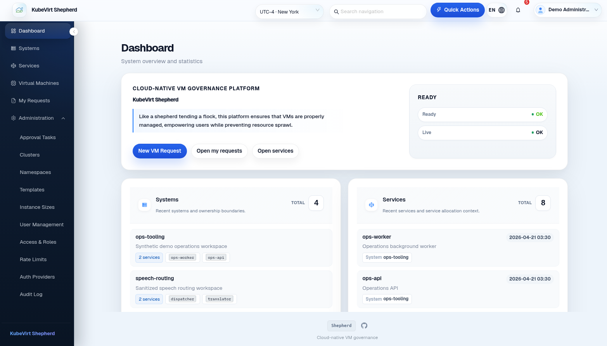

# KubeVirt Shepherd

[](https://www.apache.org/licenses/LICENSE-2.0)
[](go.mod)
[](https://github.com/kv-shepherd/shepherd/actions/workflows/ci.yml)

**[KubeVirt Shepherd official website](https://kv-shepherd.io/)** ·
**[中文官网](https://kv-shepherd.io/zh/)** ·
**[Browser demo — simulated data](https://demo.kv-shepherd.io/)** ·
**[Documentation](docs/README.md)**

KubeVirt Shepherd (kv-shepherd) is an open-source management platform for
[KubeVirt][kubevirt] virtual machines. It brings VM requests, approval policies
based on operation and environment, scoped access, and audit records into a
shared interface across managed Kubernetes/KubeVirt clusters.

This repository contains the Go backend, product web UI, and deployment assets.
The official website provides product introductions and task guides in English
and Chinese.

**Project status: Alpha.** Start with an evaluation deployment and review the
[release notes](https://github.com/kv-shepherd/shepherd/releases) before using
Shepherd with shared workloads.

The public browser demo needs no account and uses simulated data and operations.
It does not create real VMs or provide live VNC/serial consoles. Real cluster
operations require a self-hosted installation and a configured KubeVirt environment.

<p align="center">
  
</p>

## Why Shepherd?

KubeVirt solves running VMs on Kubernetes. Shepherd focuses on the operating
model around those VMs: who can request them, who approves the change, how
platform permissions are enforced, which clusters are available, and where the
audit trail lives.

Platform teams configure the resource catalog, roles, and managed clusters.
Users submit requests within those boundaries, reviewers handle requests that
require approval, and background workers execute accepted work against the
target cluster. KubeVirt remains responsible for running the virtual machines.

## Features

- Approval policies for create, modify, start, stop, restart, and delete,
  with requirements configurable by operation and environment
- Multi-cluster Kubernetes/KubeVirt management
- Platform RBAC plus System, Service, and VM membership inheritance
- Environment-scoped global role bindings
- Audit records for platform requests, review decisions, and VM operations
- Administrator visibility into audit-derived business signals and operational
  metrics, with API tracing available when an observability backend is configured
- VNC and serial console entrypoints with platform access controls
- Chinese and English UI
- Auth provider plugin SDK for LDAP, OIDC, and custom integrations
- PostgreSQL-only runtime architecture with River Queue for async work

## Architecture

```text
Web UI (React 19 + Next.js 16)
  -> Go Backend (Gin)
  -> PostgreSQL 18
  -> Kubernetes/KubeVirt clusters
```

Shepherd intentionally avoids Redis and external message queues in the default
architecture. PostgreSQL stores business state, audit data, credentials, and
River background jobs. API changes are contract-first through OpenAPI, and
architecture decisions are tracked in [docs/adr/](docs/adr/).

## Project Status

Shepherd is currently **Alpha**. Evaluate it with your Kubernetes/KubeVirt
versions, storage classes, networking, and authentication providers. Review
resource permissions, database persistence, and upgrade behavior for your
environment before connecting shared workloads.

See [CHANGELOG.md](CHANGELOG.md) for release details and
[ROADMAP.md](ROADMAP.md) for planned work.

## Quick Start

### Helm Deployment

Use this path for Kubernetes-native installs. Helm charts are maintained
separately in [kv-shepherd/helm-charts](https://github.com/kv-shepherd/helm-charts),
and the published chart uses public Docker Hub images by default.

Demo install without an Ingress controller or persistent database storage:

```bash
helm repo add shepherd https://kv-shepherd.github.io/helm-charts
helm repo update
helm upgrade --install shepherd shepherd/shepherd \
  --namespace shepherd --create-namespace \
  --set postgresql.persistence.enabled=false

kubectl -n shepherd port-forward svc/shepherd-edge 3443:443
```

Open `https://127.0.0.1:3443`. See the chart repository for NodePort/IP access,
Ingress with TLS, persistent PostgreSQL, external database values, and
managed-cluster RBAC examples. Clusters that run Prometheus Operator can apply
the public starter monitoring manifests from this repository:

```bash
kubectl -n shepherd apply \
  -f deploy/monitoring/prometheus-operator/shepherd-service-monitor.yml \
  -f deploy/monitoring/prometheus-operator/shepherd-prometheus-rule.yml
```

### Docker Compose From Release Images

Use this path for single-host or VPS installs. It uses GHCR release images and
does not require a git checkout on the target host.

Prerequisites: Docker, Docker Compose v2, and outbound access to GHCR and
GitHub release assets.

```bash
mkdir -p shepherd-deploy && cd shepherd-deploy
curl -fsSL https://raw.githubusercontent.com/kv-shepherd/shepherd/main/deploy/prod/deploy-prod.sh | \
  bash -s -- --release-images --with-seed
```

This starts the latest published GHCR images with bundled PostgreSQL 18 and a
local TLS endpoint. Generated secrets, bootstrap credentials, and resolved image
refs are persisted to `.env.prod`; back up that file.

Domain and external PostgreSQL inputs are optional. When needed, pass
`SERVER_PUBLIC_BASE_URL`, `DATABASE_URL`, and `DEPLOY_BUNDLED_POSTGRES=false`
before `bash`.

See [docs/DEPLOYMENT.md](docs/DEPLOYMENT.md) for external PostgreSQL 18,
domain/TLS configuration, image version pinning, manual compose commands,
the built-in `/metrics` endpoint, the optional Prometheus/Tempo/OpenTelemetry
Collector monitoring overlay, and the security checklist.

### Local Development

Use this path when you want to modify Shepherd or run the full stack from the
current source tree.

```bash
git clone https://github.com/kv-shepherd/shepherd.git
cd shepherd
git pull --ff-only origin main
./start-dev.sh
```

Prerequisites: Git, Go 1.25.12 or newer, Node.js 22 or newer with npm, and
Docker 24 or newer with Docker Compose v2.

Default local endpoints:

- Web UI: `http://localhost:3000`
- HTTPS dev ingress: `https://localhost:3443`
- API: `http://localhost:3000/api/v1`

### Docker Compose From Source Build

Use source-build deployment only when you intentionally want the target host to
build local backend and frontend images from a checkout.

```bash
git clone https://github.com/kv-shepherd/shepherd.git
cd shepherd
git pull --ff-only origin main
bash deploy/prod/deploy-prod.sh --source-build --with-seed
```

Both Docker Compose paths use `deploy-prod.sh`, but the mode flag is deliberate:
`--release-images` runs published images and can be used from `curl`; `--source-build`
requires a git checkout and builds local images before starting the stack. See
[docs/DEPLOYMENT.md](docs/DEPLOYMENT.md) for the full deployment guide,
configuration reference, security checklist, and VPS experience seed setup.

## Documentation

- [docs/README.md](docs/README.md) - Documentation index and quick start
- [docs/DEPLOYMENT.md](docs/DEPLOYMENT.md) - Deployment guide and security checklist
- [docs/adr/](docs/adr/) - Architecture Decision Records
- [docs/design/](docs/design/) - Design and implementation notes
- [docs/RELEASE.md](docs/RELEASE.md) - Release process
- [ADOPTERS.md](ADOPTERS.md) - Organizations using Shepherd

## Community

Feedback from real environments is especially useful while the project is in
Alpha.

- [KubeVirt Shepherd official website](https://kv-shepherd.io/) - Product overview and task guides
- [KubeVirt Shepherd 中文官网](https://kv-shepherd.io/zh/) - 中文产品介绍与场景指南
- [Discord](https://discord.gg/9P2wtpPMUe) - Chat with the community
- [GitHub Issues][issues] - Bug reports, feature requests, and usage questions
- [Contributing](CONTRIBUTING.md) - PR workflow, CI gates, and coding standards
- [Code of Conduct](CODE_OF_CONDUCT.md) - Community standards
- [Governance](GOVERNANCE.md) - Project governance
- [Security](SECURITY.md) - Vulnerability reporting

## License

Apache License 2.0 - See [LICENSE](LICENSE).

Copyright The KubeVirt Shepherd Authors.

[kubevirt]: https://kubevirt.io
[issues]: https://github.com/kv-shepherd/shepherd/issues
